

<picture>
  <source media="(prefers-color-scheme: dark)" srcset="https://raw.githubusercontent.com/harlanljones/harlanljones/profile-cards/header.svg">
  <source media="(prefers-color-scheme: light)" srcset="https://raw.githubusercontent.com/harlanljones/harlanljones/profile-cards/header-light.svg">
  <a href="https://harlanljones.com"></a>
</picture>

  [harlanljones.com](https://harlanljones.com) &nbsp;·&nbsp; [LinkedIn](https://www.linkedin.com/in/harlanljones) &nbsp;·&nbsp; [Repositories](https://github.com/harlanljones?tab=repositories) &nbsp;·&nbsp; [Featured Projects](#-featured-repositories--project-websites) &nbsp;·&nbsp; [Glossary & Architecture](#-sabermetric-glossary--architecture-details)

<picture>
  <source media="(prefers-color-scheme: dark)" srcset="https://raw.githubusercontent.com/harlanljones/harlanljones/profile-cards/mlb-birthday-index.svg">
  <source media="(prefers-color-scheme: light)" srcset="https://raw.githubusercontent.com/harlanljones/harlanljones/profile-cards/mlb-birthday-index-light.svg">
  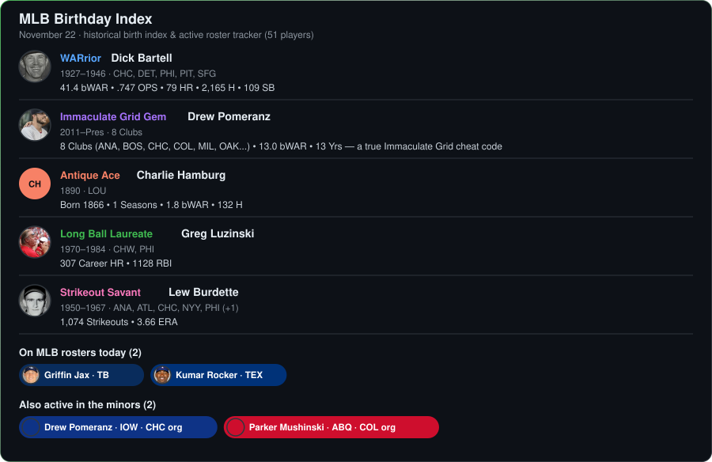
</picture>

<table>
  <tr>
    <td width="50%" valign="top">
<picture>
  <source media="(prefers-color-scheme: dark)" srcset="https://raw.githubusercontent.com/harlanljones/harlanljones/profile-cards/weekly-highlights.svg">
  <source media="(prefers-color-scheme: light)" srcset="https://raw.githubusercontent.com/harlanljones/harlanljones/profile-cards/weekly-highlights-light.svg">
  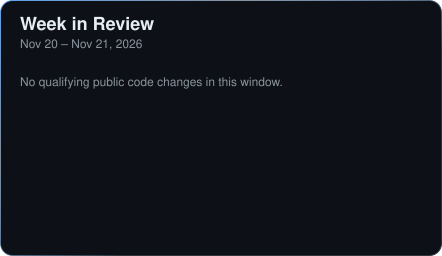
</picture>
    </td>
    <td width="50%" valign="top">
<picture>
  <source media="(prefers-color-scheme: dark)" srcset="https://raw.githubusercontent.com/harlanljones/harlanljones/profile-cards/statline.svg">
  <source media="(prefers-color-scheme: light)" srcset="https://raw.githubusercontent.com/harlanljones/harlanljones/profile-cards/statline-light.svg">
  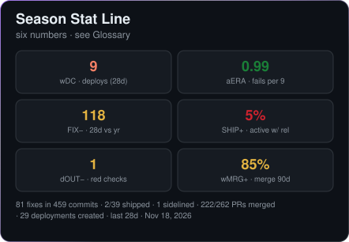
</picture>
    </td>
  </tr>
</table>

<picture>
  <source media="(prefers-color-scheme: dark)" srcset="https://raw.githubusercontent.com/harlanljones/harlanljones/profile-cards/repo-leaderboard.svg">
  <source media="(prefers-color-scheme: light)" srcset="https://raw.githubusercontent.com/harlanljones/harlanljones/profile-cards/repo-leaderboard-light.svg">
  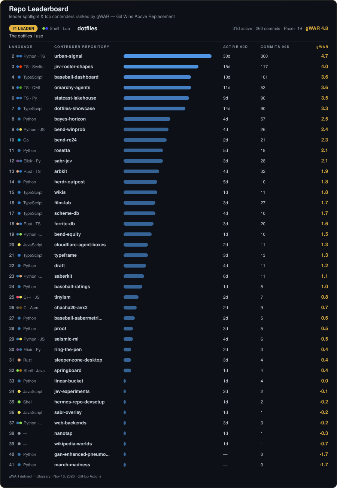
</picture>

<table>
  <tr>
    <td width="50%" valign="top">
<picture>
  <source media="(prefers-color-scheme: dark)" srcset="https://raw.githubusercontent.com/harlanljones/harlanljones/profile-cards/projects-pulse.svg">
  <source media="(prefers-color-scheme: light)" srcset="https://raw.githubusercontent.com/harlanljones/harlanljones/profile-cards/projects-pulse-light.svg">
  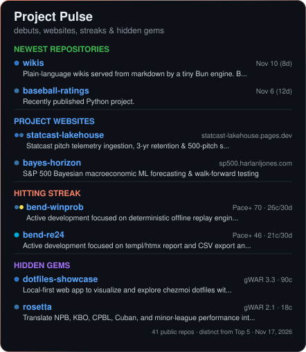
</picture>
    </td>
    <td width="50%" valign="top">
<picture>
  <source media="(prefers-color-scheme: dark)" srcset="https://raw.githubusercontent.com/harlanljones/harlanljones/profile-cards/dev-grid.svg">
  <source media="(prefers-color-scheme: light)" srcset="https://raw.githubusercontent.com/harlanljones/harlanljones/profile-cards/dev-grid-light.svg">
  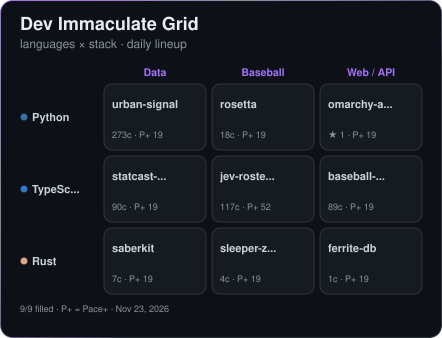
</picture>
    </td>
  </tr>
</table>

<strong>🚀 Featured Repositories &amp; Project Websites</strong>

| Project | Focus | Tech Stack | Live Site |
| :--- | :--- | :--- | :--- |
| [**urban-signal**](https://github.com/harlanljones/urban-signal) | Real-time spatio-temporal property forecasting & telemetry | `Python` · `Kafka` · `FastAPI` | [urban-signal.harlanljones.com](https://urban-signal.harlanljones.com) |
| [**statcast-lakehouse**](https://github.com/harlanljones/statcast-lakehouse) | Statcast pitch telemetry ingestion, 3-yr retention & 500-pitch scenarios | `Python` · `TypeScript` | — |
| [**sabr-jev**](https://github.com/harlanljones/sabr-jev) | Sabermetric valuation engine, historical backtests & interactive cards | `Python` | [sabr.harlanljones.com](https://sabr.harlanljones.com) |
| [**omarchy-agents**](https://github.com/harlanljones/omarchy-agents) | AI coding-agent usage tracking, token correlation & desktop widgets | `TypeScript` · `Bun` · `React` | [agents.harlanljones.com](https://agents.harlanljones.com) |
| [**baseball-dashboard**](https://github.com/harlanljones/baseball-dashboard) | Live MLB scoreboard, sabermetric matchup splits & bullpen workload | `TypeScript` · `Next.js` · `React` | [mlb.harlanljones.com](https://mlb.harlanljones.com/) |
| [**arbkit**](https://github.com/harlanljones/arbkit) | Cross-venue sports & prediction market arbitrage engine (p99 &lt; 250ns) | `Rust` · `Performance` · `Architecture` | [arbkit.harlanljones.com](https://arbkit.harlanljones.com/) |
| [**bayes-horizon**](https://github.com/harlanljones/bayes-horizon) | S&P 500 Bayesian macroeconomic ML forecasting & walk-forward testing | `Python` · `PyMC` · `FastAPI` | [sp500.harlanljones.com](https://sp500.harlanljones.com/) |
| [**dotfiles**](https://github.com/harlanljones/dotfiles) | Automated developer workspace, Chezmoi configs & agent tooling | `Go Templates` · `Shell` | — |
| [**ferrite-db**](https://github.com/harlanljones/ferrite-db) | Embedded Rust approximate nearest-neighbor vector search library | `Rust` · `TypeScript` | [ferritedb.harlanljones.com](https://ferritedb.harlanljones.com/) |
| [**scheme-db**](https://github.com/harlanljones/scheme-db) | Interactive NFL scheme engineering & 80-play animation workstation | `TypeScript` · `React` · `Tailwind` | [schemedb.harlanljones.com](https://schemedb.harlanljones.com/) |
| [**film-lab**](https://github.com/harlanljones/film-lab) | Automated darkroom simulation & photo-processing pipeline | `TypeScript` · `JavaScript` | [film-lab.harlanljones.com](https://film-lab.harlanljones.com/) |
| [**seismic-ml**](https://github.com/harlanljones/seismic-ml) | Spatiotemporal ML pipeline for short-term USGS earthquake forecasting | `Python` · `TensorFlow` · `CUDA` | — |
| [**herdr-outpost**](https://github.com/harlanljones/herdr-outpost) | Remote mTLS dashboard & relay gateway for AI coding agent workspaces | `Python` · `Cloudflare` · `Cloudflare Tunnel` | — |
| [**march-madness**](https://github.com/harlanljones/march-madness) | PyTorch deep learning tournament prediction & bracket simulation | `Python` · `PyTorch` · `Monte Carlo` | — |
| [**saberkit**](https://github.com/harlanljones/saberkit) | High-performance Rust sabermetric valuation & statistics engine | `Python` · `Rust` | — |

<picture>
  <source media="(prefers-color-scheme: dark)" srcset="https://raw.githubusercontent.com/harlanljones/harlanljones/profile-cards/skills.svg">
  <source media="(prefers-color-scheme: light)" srcset="https://raw.githubusercontent.com/harlanljones/harlanljones/profile-cards/skills-light.svg">
  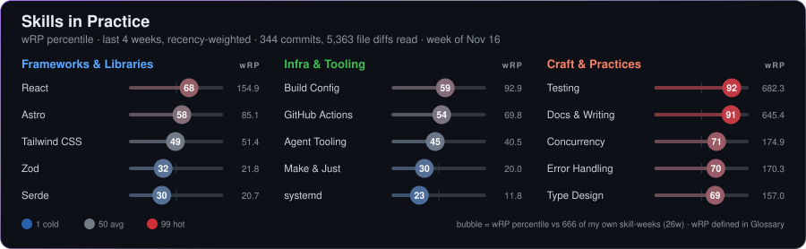
</picture>

<picture>
  <source media="(prefers-color-scheme: dark)" srcset="https://raw.githubusercontent.com/harlanljones/harlanljones/profile-cards/activity.svg">
  <source media="(prefers-color-scheme: light)" srcset="https://raw.githubusercontent.com/harlanljones/harlanljones/profile-cards/activity-light.svg">
  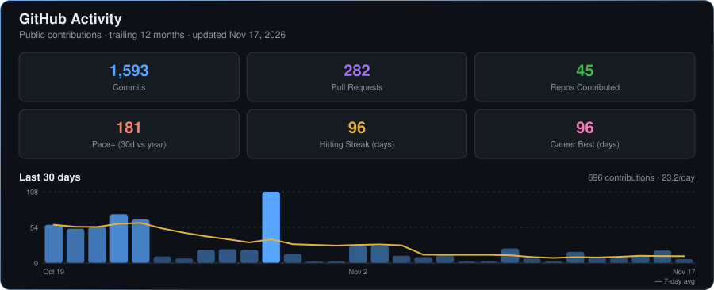
</picture>

<picture>
  <source media="(prefers-color-scheme: dark)" srcset="https://raw.githubusercontent.com/harlanljones/harlanljones/profile-cards/commit-rhythm.svg">
  <source media="(prefers-color-scheme: light)" srcset="https://raw.githubusercontent.com/harlanljones/harlanljones/profile-cards/commit-rhythm-light.svg">
  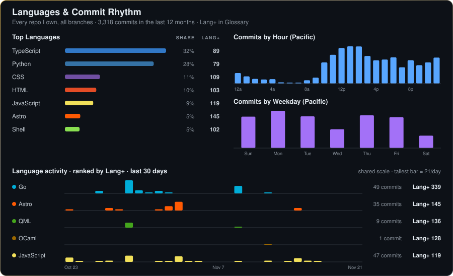
</picture>

<strong>📊 Sabermetric Glossary &amp; Architecture Details</strong>

<picture>
  <source media="(prefers-color-scheme: dark)" srcset="https://raw.githubusercontent.com/harlanljones/harlanljones/profile-cards/glossary.svg">
  <source media="(prefers-color-scheme: light)" srcset="https://raw.githubusercontent.com/harlanljones/harlanljones/profile-cards/glossary-light.svg">
  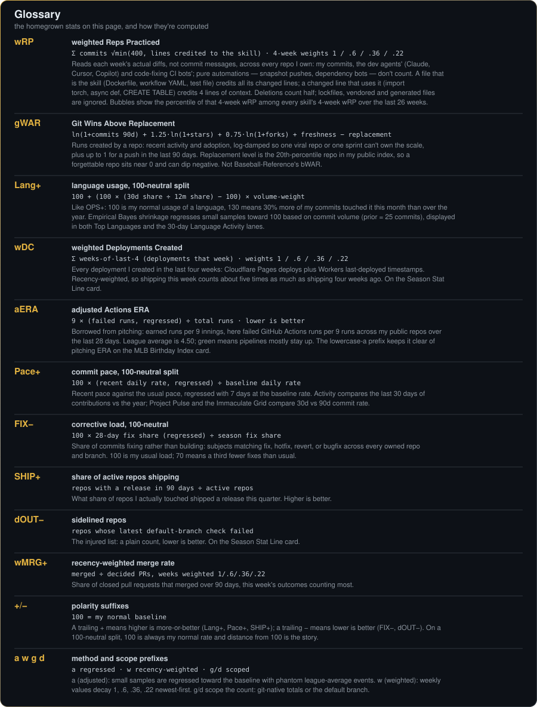
</picture>

<picture>
  <source media="(prefers-color-scheme: dark)" srcset="https://raw.githubusercontent.com/harlanljones/harlanljones/profile-cards/pipeline.svg">
  <source media="(prefers-color-scheme: light)" srcset="https://raw.githubusercontent.com/harlanljones/harlanljones/profile-cards/pipeline-light.svg">
  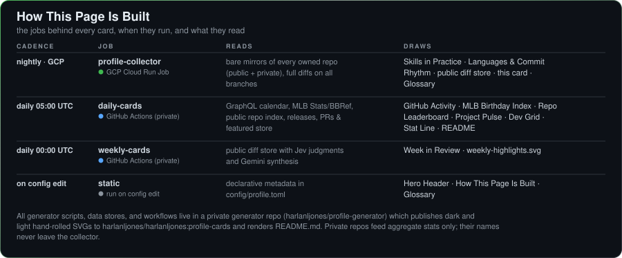
</picture>

<picture>
  <source media="(prefers-color-scheme: dark)" srcset="https://raw.githubusercontent.com/harlanljones/harlanljones/profile-cards/footer.svg">
  <source media="(prefers-color-scheme: light)" srcset="https://raw.githubusercontent.com/harlanljones/harlanljones/profile-cards/footer-light.svg">
  
</picture>

